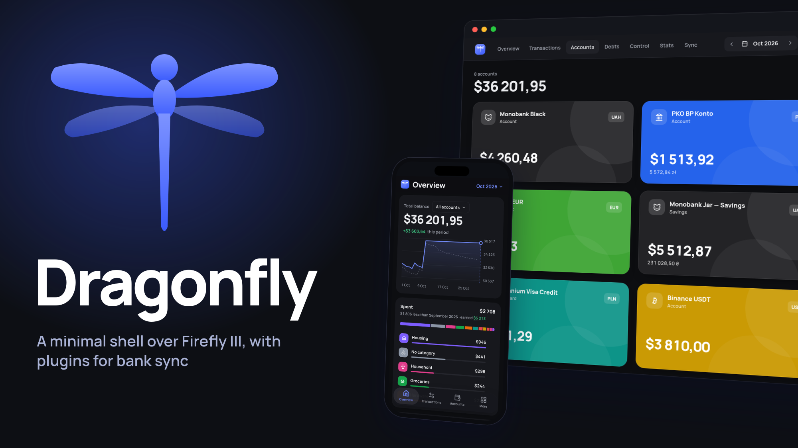

# Dragonfly



[](https://github.com/firefly-iii/firefly-iii) [](https://svelte.dev) [](https://www.python.org) [](https://sladge.net)

A minimal shell over [Firefly III](https://github.com/firefly-iii/firefly-iii) with a plugin system for bank sync.

This is not a full Firefly client. It covers only the parts of Firefly I need: overview, transactions, accounts, debts, budgets, subscriptions, piggy banks and stats. Everything else stays in the stock Firefly UI, one click away.

Development was based on the [Firefly client by haikesan](https://git.kotikot.com/apps/firefly-ui).

## Install

You need a running Firefly III, Docker, [uv](https://docs.astral.sh/uv/) and a reverse proxy.

```sh
cd ui
make env
make rebuild
```

```sh
cd sync
FIREFLY_URL=http://firefly:8080 FIREFLY_TOKEN_FILE=token FFSYNC_PLUGINS=plugins uv run ffsync
```

`token` is a file with a Firefly access token. On your proxy, put the UI on Firefly's domain and route `/sync/*` to the core (`127.0.0.1:38091`) behind auth, since it has none of its own. [Caddy example](ui/caddy/fireflyiii.site.caddy).

## Plugins

A plugin is a folder with `manifest.toml` and `plugin.py` that fetches transactions from a bank or processes them. Drop it into `FFSYNC_PLUGINS` and it shows up in the Sync tab. See [docs/plugins.md](docs/plugins.md).
